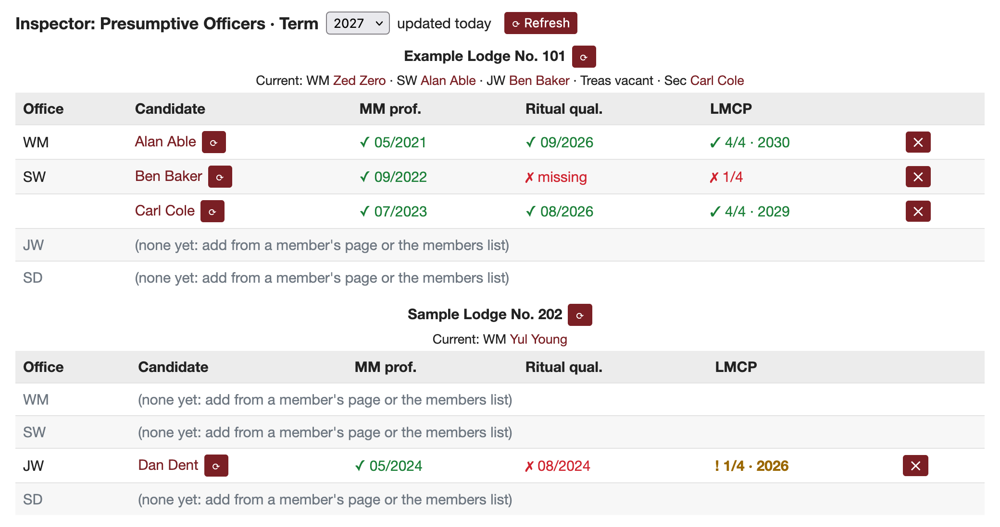

# Inspector Dashboard Helper

A Firefox extension for Masonic Inspectors in the Grand Lodge of California. It adds a panel to the district dashboard on [member.freemason.org](https://member.freemason.org) that shows, on one screen, each lodge's current officers and whether next year's presumptive WM, SW, JW and SD meet their qualification requirements:

- Master Mason proficiency;
- ritual Officer Qualification (within the last 24 months);
- LMCP courses (within the last 5 years), counted against what each office needs.

You build the roster yourself with an "Add as presumptive…" control on member pages and on the district members list. An office can have more than one candidate.



*Screenshot from a synthetic copy of the site; all names and dates are made up.*

## Install

You need Firefox 140 or later, on desktop.

1. In Firefox, open the [latest release](https://github.com/clintcparker/inspector-ext/releases/latest).
2. Under **Assets**, click the `.xpi` file. Firefox asks whether to add **Inspector Dashboard Helper**. Click **Add**.
3. Sign in to [member.freemason.org](https://member.freemason.org) and open your district dashboard. The panel appears on that page.

Mozilla signs the extension, but it isn't listed on addons.mozilla.org. It also doesn't update itself yet. To update, install the newer `.xpi` from the releases page the same way.

## Privacy

The extension only talks to member.freemason.org, using the session you are already signed in with. Everything it fetches and the roster you build stay in your browser's extension storage. Nothing is sent anywhere else, and no data is collected.

## Development

```sh
npm install
npm test            # lint, unit tests, end-to-end test in a throwaway headless Firefox
npm run build       # zip into web-ext-artifacts/
npm run screenshot  # regenerate docs/screenshot.png from the synthetic site
npm run sign        # sign on AMO (unlisted); needs WEB_EXT_API_KEY/SECRET in .env
```

The end-to-end test and screenshot script expect Firefox Developer Edition; set `FIREFOX_BIN` to use another Firefox.

## License

[MIT](LICENSE)
